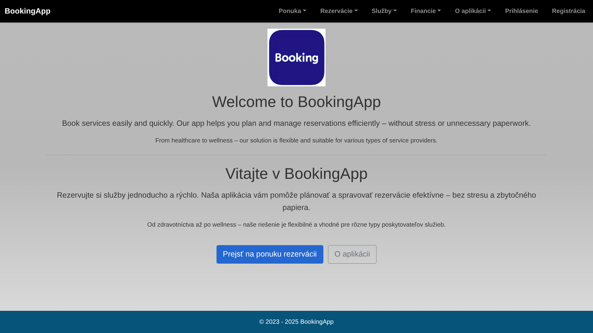
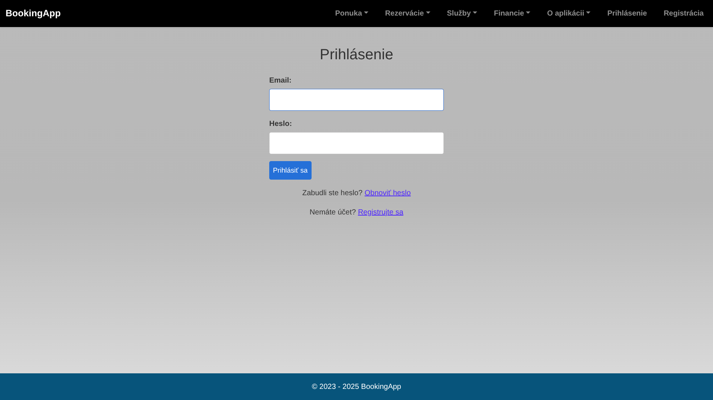
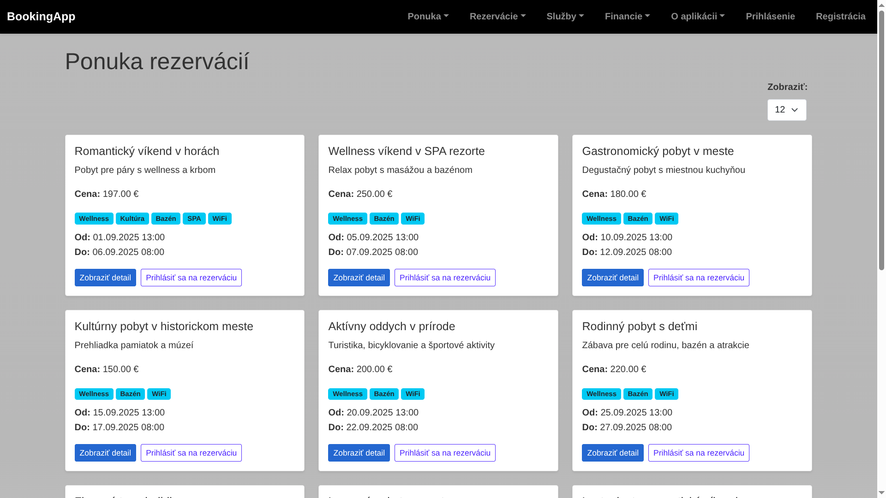
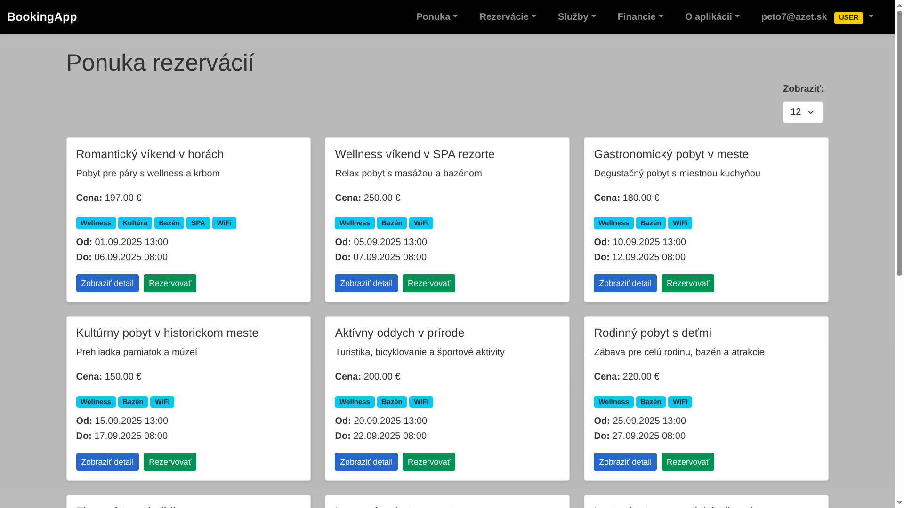
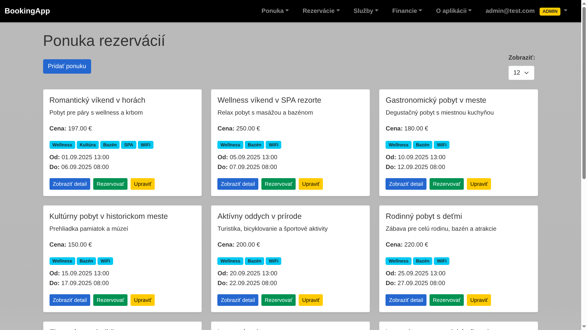
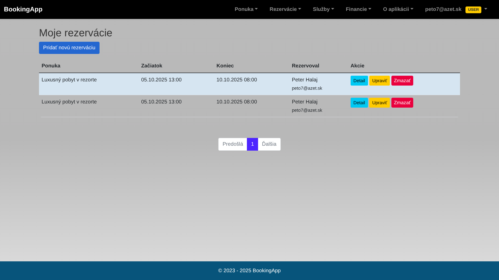
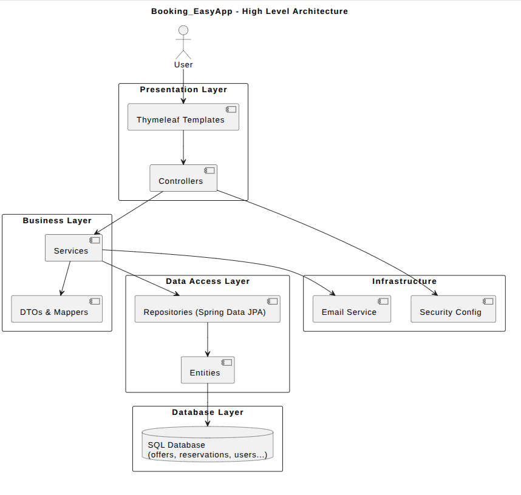
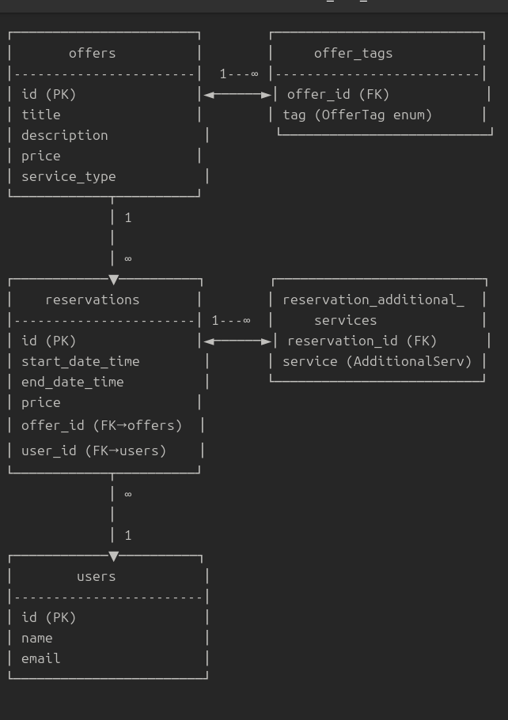

# 🛡️ Booking EasyApp

A web application for managing offers and reservations, built with **Java**, **Spring Boot**, **Spring Security**, **Thymeleaf**, and **PostgreSQL**.

---

## 🚀 Run the Project

The project can be run locally using Docker Compose and Maven.

For local development, configure your own environment variables and database credentials. No production credentials are stored in this repository.

---

## 👥 User Roles and Registration

- 👤 **Admin** can manage offers and reservations.
- 📝 **Users** can register and manage their reservations.
- 🔒 Protected application areas are controlled through **Spring Security** and role-based access.

No test passwords or production credentials are stored in this repository.

---

## 🔐 Security

The application includes several security and validation measures:

- **Spring Security** with session-based authentication
- role-based access restrictions
- secure password hashing
- server-side input validation
- strict email validation
- password reset by email
- UUID reset tokens
- reset links valid for 15 minutes
- reset tokens invalidated after a successful password reset
- restricted network exposure of internal services in production

The application and its production deployment were reviewed and tested with a focus on input validation, authentication, password reset security, and network exposure.

---

## 🔑 Password Reset

The application supports password reset by email.

- reset tokens are generated as UUIDs
- reset links are valid for 15 minutes
- a token is invalidated after a successful password reset
- email configuration is provided through environment variables

No passwords, SMTP credentials, or other production secrets are stored in the repository.

---

## 🖼️ Screenshots

### Home & Login

| Home Page | Login Page |
| --- | --- |
|  |  |

### Offers – Guest / User / Admin

| Guest View | User View | Admin View |
| --- | --- | --- |
|  |  |  |

### My Reservations



---

## 🏗️ System Architecture



## 🗄️ Database ER Diagram



---

## 📡 REST API

| Method | Endpoint | Description |
| --- | --- | --- |
| GET | `/api/reservations` | List reservations |
| POST | `/api/reservations` | Create reservation |
| PUT | `/api/reservations/{id}` | Update reservation |
| DELETE | `/api/reservations/{id}` | Delete reservation |

---

## 🛠️ Technologies Used

### Backend & Core

- Java 17
- Spring Boot
- Spring Security
- Spring Data JPA / Hibernate
- Thymeleaf
- PostgreSQL
- Maven
- Bean Validation

### Deployment & Infrastructure

- Docker
- Docker Compose
- Linux / Ubuntu
- NGINX
- SSL / Let's Encrypt
- Oracle Cloud

### Other

- Bootstrap 5
- REST API
- File upload and storage
- JUnit / Mockito

---

## 🗂️ Project Structure

```text
src/
├── main/
│   ├── java/com/booking/app/
│   │   ├── controllers       # Web and REST controllers
│   │   ├── data              # Entities, enums, repositories
│   │   ├── models            # DTOs, mappers, exceptions, services
│   │   └── configuration     # Security configuration
│   └── resources/
│       ├── templates/        # Thymeleaf templates
│       ├── static/           # CSS, JavaScript, images
│       ├── application.properties
│       ├── application-local.properties
│       └── application-prod.properties
└── test/                     # Unit and integration tests
```

---

## 🗄️ Database

The application uses **PostgreSQL**.

Production database configuration is provided through environment variables and is not stored in the repository.

Database initialization and application data are managed separately from the public source code.

---

## 🐳 Running Locally

### Requirements

- Java 17+
- Maven
- Docker
- Docker Compose

### Start the application environment

```bash
docker compose up --build -d
```

The application is available locally on:

```text
http://localhost:8080
```

Alternatively, the Spring Boot application can be started directly with Maven:

```bash
./mvnw spring-boot:run
```

---

## 🧪 Tests

The project includes unit and integration tests.

Run the test suite with:

```bash
./mvnw test
```

---

## ☁️ Production Deployment

The application is deployed in a containerized production environment.

The production setup uses:

- Linux / Ubuntu
- Docker Compose
- PostgreSQL
- NGINX reverse proxy
- HTTPS with Let's Encrypt
- Oracle Cloud

Internal services are not intended to be directly exposed to the public internet.

---

## 📚 Documentation

Additional technical documentation is available in the `docs/` directory.

The documentation contains run instructions and technical troubleshooting notes related to development and deployment.

---

## 📌 Features

- User registration and login
- Role-based access
- Offer management
- Reservation management
- REST API
- File upload and storage
- Email notifications
- Password reset
- Server-side validation
- Custom error pages
- Admin features

---

## 📄 License

This project is licensed under the MIT License.
